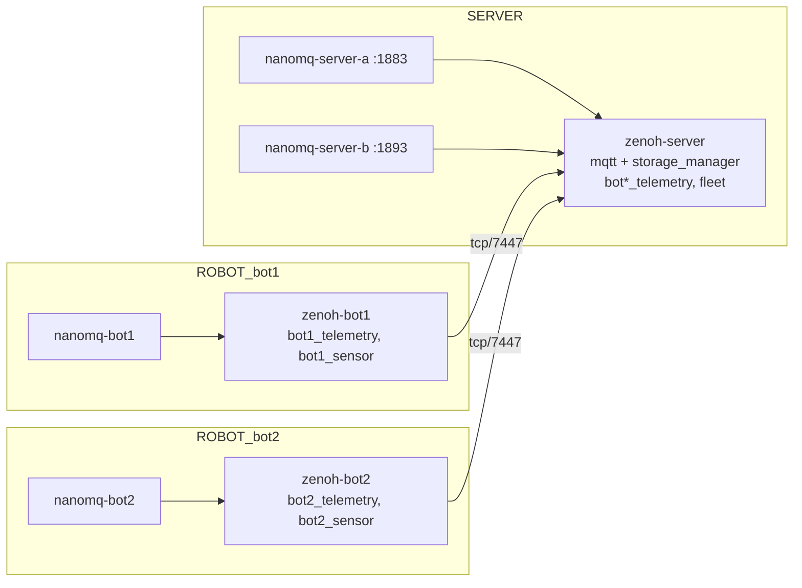

# NanoMQ Cluster over Zenoh (robot + server storage)

This stack runs **several NanoMQ brokers** — one on every robot and two on the
server — and joins them into one cluster over a Zenoh router fabric. Its main job
is to decide **where each topic is stored**: on the robot, on the server, or on
both.

NanoMQ has no native clustering. Each NanoMQ node bridges into the Zenoh router
on its own machine (Zenoh MQTT plugin). The routers do the routing between
machines, and Zenoh storages handle persistence.

## Architecture



## Topic placement

| MQTT topic | Direction | Stored on robot | Stored on server |
|------------|-----------|:---:|:---:|
| `robots/<id>/telemetry/#` (pose, battery, status) | robot → server | ✅ | ✅ (replicated) |
| `robots/<id>/sensor/#` (imu, temperature, raw) | stays on robot | ✅ | ❌ |
| `robots/<id>/cmd/#` | server → robot | – | – |
| `fleet/#` (missions, maps, fleet config) | server | ❌ | ✅ |

To change what goes where, edit the `storages` blocks in
`cluster/robots/<id>/zenoh.json5` and `cluster/server/zenoh.json5`, and the
`forwards` / `subscription` lists in the matching `nanomq*.conf` files.

How the "both" case works: the robot and the server each have a storage with the
**same `key_expr` and the same `replication` settings** (for example
`bot1_telemetry`). Zenoh replication compares digests of the two storages and
fills in whatever is missing. If the robot loses its link, it keeps storing
locally, and the server copy catches up after the link comes back.

!!! note "Storage semantics"
    A Zenoh storage keeps the **latest value per key** (state). It does not keep
    a time series. For a full message history, use a time-series Zenoh backend
    (for example InfluxDB) for the same `key_expr`.

!!! note "No bridge loops"
    No bridge both forwards and subscribes the same topic. Robots forward
    telemetry and sensor topics and subscribe to `cmd`. Server nodes subscribe to
    telemetry and forward `cmd` and `fleet`. Every server node receives all robot
    telemetry, and a command published on any server node reaches the robot.

## Files

```
docker-compose-cluster.yaml          # single host: server + bot1 + bot2 (+ --profile sim)
docker-compose-cluster-server.yaml   # real deployment: server machine
docker-compose-cluster-robot.yaml    # real deployment: each robot (ROBOT_ID, SERVER_HOST)
cluster/
  server/zenoh.json5                 # server router, per-robot replicated storages, fleet/**
  server/nanomq-a.conf, nanomq-b.conf
  robots/<id>/zenoh.json5            # robot router, <id>_telemetry (replicated) + <id>_sensor (local)
  robots/<id>/nanomq.conf
  plugins/lib/                       # zenoh 1.0.0 plugin .so files (git-ignored)
  data/                              # runtime storage (git-ignored)
  scripts/fetch-zenoh-plugins.sh     # copy plugin libs into plugins/lib
  scripts/add-robot.sh               # generate a new robot + server storage
  scripts/check-storage.sh           # show which node stores which topics
  scripts/sim-robot.sh               # shell robot simulator (nanomq_cli, --profile sim)
```

## Prerequisite: Zenoh plugins

The routers use `eclipse/zenoh:1.0.0` and load the MQTT, storage-manager and
filesystem-backend plugins from `cluster/plugins/lib`. These `.so` files must
match zenohd **1.0.0** exactly. They are x86_64 builds, so the containers run
with `platform: linux/amd64` (on Apple Silicon this uses Rosetta emulation).

```bash
./cluster/scripts/fetch-zenoh-plugins.sh                 # from ../zenoh-mqtt-nanomq/zenoh/lib
./cluster/scripts/fetch-zenoh-plugins.sh /path/to/lib    # or from another directory
```

## Run on a single host

```bash
docker compose -f docker-compose-cluster.yaml up -d
docker compose -f docker-compose-cluster.yaml --profile sim up -d   # simulated robots (cluster/scripts/sim-robot.sh)

# watch the fleet from the server cluster (node a or b) — nanomq_cli ships in the NanoMQ image
docker exec -it nanomq-server-a nanomq_cli sub -h localhost -p 1883 -t 'robots/+/telemetry/#'
docker exec -it nanomq-server-b nanomq_cli sub -h localhost -p 1883 -t 'robots/+/telemetry/#'

# send a command from the server (node b) to bot1, watch it arrive: docker logs -f sim-bot1
docker exec nanomq-server-b nanomq_cli pub -h localhost -p 1883 -q 1 \
  -t robots/bot1/cmd/vel -m '{"linear":0.5,"angular":0.2}'

# sensor topics stay on the robot: visible on nanomq-bot1, never on the server nodes
docker exec -it nanomq-bot1 nanomq_cli sub -h localhost -p 1883 -t 'robots/bot1/sensor/#'

# where is everything stored?
./cluster/scripts/check-storage.sh
curl -s 'http://localhost:8000/robots/bot1/telemetry/**'   # server REST
curl -s 'http://localhost:8101/robots/bot1/sensor/**'      # bot1 REST
```

| Service | Host port |
|---------|-----------|
| zenoh-server (router / REST) | 7447 / 8000 |
| nanomq-server-a / -b | 1883 / 1893 |
| nanomq-bot1 / zenoh-bot1 REST | 2883 / 8101 |
| nanomq-bot2 / zenoh-bot2 REST | 3883 / 8102 |

### Offline test

```bash
docker compose -f docker-compose-cluster.yaml stop zenoh-server
sleep 30                                   # robots keep storing telemetry locally
docker compose -f docker-compose-cluster.yaml start zenoh-server
sleep 30                                   # replication catches up
./cluster/scripts/check-storage.sh
```

## Run on real machines

```bash
# server
docker compose -f docker-compose-cluster-server.yaml up -d

# each robot (open TCP 7447 on the server)
ROBOT_ID=bot1 SERVER_HOST=192.168.1.10 docker compose -f docker-compose-cluster-robot.yaml up -d
```

Adding a robot:

```bash
./cluster/scripts/add-robot.sh bot3        # robots/bot3/* + server storage bot3_telemetry
docker compose -f docker-compose-cluster-server.yaml restart zenoh-server
# copy the repo (incl. cluster/plugins/lib) to the robot, then:
ROBOT_ID=bot3 SERVER_HOST=192.168.1.10 docker compose -f docker-compose-cluster-robot.yaml up -d
```

## Limits and next steps

- The server can still **query** robot-only topics on demand: a REST or `get`
  call on `robots/bot1/sensor/**` reaches the robot storage. Nothing is
  streamed or stored on the server. To block this completely, add a Zenoh
  `access_control` rule on the robot router.
- Robot-local storages grow with the number of distinct keys, not the message
  count (latest value per key).
